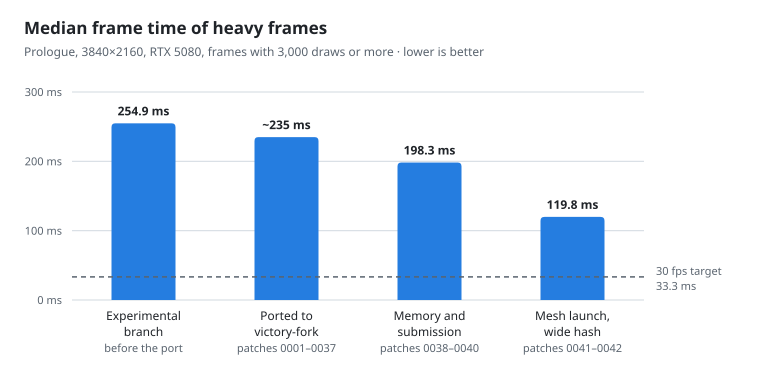
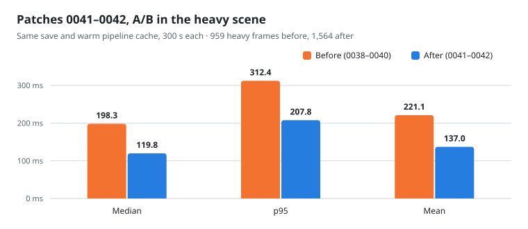

# Kelvaroq

     

Kelvaroq is an Xbox Series X|S compatibility runtime for Windows x64, written in Rust. Its native engine is built on VIctory and victory-fork. The goal is a playable scene at 3840×2160 and 30 rendered fps, with correct textures and steady frame pacing on NVIDIA and AMD GPUs.

## Status

**The prologue is playable at about 10 rendered fps in typical views and 7 to 8 fps in its heaviest scenes.** All measurements below are from the prologue at 3840×2160 on an RTX 5080. A heavy frame is a present with at least 3,000 draws.

Verified in play: the menus work, the character can be controlled, the HUD is shown, the game pauses, and sessions have run without a crash.

Patches 0041–0042 cut median heavy-frame time from 198.3 to 119.8 ms, and patches 0044–0048 to 108.5 ms. The thread that prepares and submits GPU work now limits heavy frames: the GPU waits for it. About 7% of draws are still dropped, mostly because ray-tracing structures are not built yet. Textures wait for space when VRAM is full.

<picture>
  <source media="(prefers-color-scheme: dark)" srcset="assets/charts/milestones-dark.svg">
  <source media="(prefers-color-scheme: light)" srcset="assets/charts/milestones-light.svg">
  
</picture>

<picture>
  <source media="(prefers-color-scheme: dark)" srcset="assets/charts/ab-0041-dark.svg">
  <source media="(prefers-color-scheme: light)" srcset="assets/charts/ab-0041-light.svg">
  
</picture>

The before and after runs used the same save and the same warm pipeline cache for 300 s each. Captures from both runs were checked for rendering errors. Frame times and mean fps in the table cover heavy frames. [Measurement protocol](documentation.md#mesure-de-la-scène-lourde) · [Mesh launch patch](documentation.md#travail-de-la-carte--dessins-mesh-lancés-par-la-carte-correctif-0041)

| Stage | Median | 95th percentile | Mean | Mean fps | Heavy frames | GPU busy |
| --- | ---: | ---: | ---: | ---: | ---: | ---: |
| Experimental branch before the port | 254.9 ms | — | — | — | — | — |
| Port to victory-fork, 0001–0037 | ~235 ms | — | — | — | — | — |
| Memory and submission, 0038–0040 (before) | 198.3 ms | 312.4 ms | 221.1 ms | 4.5 | 959 | ~78% |
| Mesh launch and wide hash, 0041–0042 (after) | 119.8 ms | 207.8 ms | 137.0 ms | 7.3 | 1,564 | ~35% |
| In-process copies, changed pages, async present, 0044–0048 | 108.5 ms | 261.5 ms | 132.2 ms | 7.6 | 1,648 | ~30% |
| 30 fps target | 33.3 ms | — | — | — | — | — |

The three runs of the initial victory-fork port had heavy-frame medians of 215, 235 and 255 ms.

## Milestones

- [x] Inspect PE files and run the title's startup in a Unicorn-based CPU reference engine.
- [x] Run the title and render its first rooms with the native engine built on VIctory.
- [x] Pin victory-fork to `f85101b` and apply patches 0001–0037 for texture uploads and placement, parallel refresh and pipeline waits, among other changes.
- [x] Apply patches 0038–0040 to read table constants from the GPU copy, place read-only copies in CPU-visible VRAM through Resizable BAR, submit work on a dedicated thread and run copies on the copy engine.
- [x] Apply patches 0041–0042 so the GPU launches mesh draws through an amplification stage, eliminating the clamp pass and full waits between mesh draws. GPU hashing uses 64 threads per block. Together these changes cut median heavy-frame time by 40%.
- [x] Display the Kelvaroq name in the engine window and release the project as free software under the GPL.
- [x] Copy game memory in place instead of through the kernel (patch 0044): 7–12% less frame time at 5,000 draws and more; frame-time spikes over one second are gone.
- [x] Ask Windows for changed pages once per reservation and submission (patch 0045): heavy-frame median 129 → 110 ms in an A/B.
- [x] Present asynchronously, at most two frames ahead (patches 0046, 0048): the game no longer waits in present; p95 568 → 262 ms.
- [ ] Spread the submitting thread's work (about 86 ms per heavy frame) over several threads: it is now the only critical path. *Next.*
- [ ] Run 64-lane compute shaders on 32-lane GPUs, and build ray-tracing structures (about 515 dropped draws per frame).
- [ ] Address the remaining ~1,400 clamped indirect calls per frame across non-mesh draws and compute dispatches.
- [ ] Address the VRAM budget and missing host pipelines.
- [ ] Reach 30 rendered fps in the heavy prologue scene.

## Play (Windows package)

1. Extract the entire Windows x64 ZIP into a folder.
2. Open **Kelvaroq.exe** and select the game folder or its executable. You can also drag either onto Kelvaroq.exe.
3. The launcher uses the native engine in the ZIP. The game opens a rendering window and a console named **Kelvaroq | Journal du jeu**.

`Kelvaroq.exe --experimental-render` (or `kelvaroq play --experimental-render <folder>`) starts an older experimental profile that reserves up to 256 MiB for VRAM transfers and 128 MiB for small read-only resources. It is not faster on the RTX 5080; the default settings are recommended. User-defined `VICTORY_*` settings take precedence. [Memory and submission settings](documentation.md#placement-mémoire-et-soumission)

The native engine uses VIctory's loader, audio and input. Kelvaroq's Rust crate prepares textures and measures frame pacing. The package also includes the reference engine and its interpreter. You can move the folder as long as its files stay together.

When you select a folder, the launcher uses the Series executable declared in `MicrosoftGame.config`. If the manifest is missing, the launcher accepts a folder containing a single `.exe`. If the choice is ambiguous, select the executable directly.

The Series X profile presents to a 3840×2160 surface and fits the window to the desktop. Intermediate rendering passes can use other resolutions.

## Build from source

On Windows, use stable Rust with the x64 MSVC target, Visual Studio Build Tools with the Windows SDK, and 64-bit Python 3.11 or later. Run these commands in PowerShell from the repository root.

```powershell
cargo build --release --locked
python scripts/build_native.py
python -m venv .venv
.\.venv\Scripts\python -m pip install -e './research[dev]'
git config core.hooksPath .githooks
```

The native build script fetches the pinned revision, applies the rendering patches and adds `native/kelvaroq-render` to the build. To use an existing clone, run `python scripts/build_native.py --source <clone>`. The native engine can use VIctory's local saves and cache.

To rebuild the prototype ZIP on Windows, run `python scripts/package_windows.py`. The script includes third-party notices, verifies checksums and tests the extracted archive outside the repository. It writes the ZIP to `target/dist/`. The reference engine uses Unicorn under GPLv2. The package includes its notice and corresponding upstream source. [Unicorn license](https://github.com/unicorn-engine/unicorn/blob/2.1.4/COPYING)

## Command line

`inspect` reports a PE file's hash, entry point, sections and imports. With `--json`, it also reports the addresses needed for startup. `boot` executes instructions in guest memory. Replace the example path with the path to your local file.

```powershell
$image = 'D:\images\example.exe'
.\target\release\kelvaroq inspect $image
.\target\release\kelvaroq boot $image --python .\.venv\Scripts\python.exe
.\target\release\kelvaroq play $image
.\target\release\kelvaroq gpu
```

`boot` writes a JSON report. Exit code 0 means the entry point returned, 2 means guest execution stopped with a diagnostic, and 1 indicates a tool or loading error.

`play` uses the native engine installed at `native/victory.exe` beside the CLI. `play --reference` opens the debugger. The CLI also opens the debugger in a development build without a native backend.

Both commands default to the Series X profile and accept `--console series-s`. The manifest selects the SMT setting. To compare CPU discovery results, `--host-topology` exposes the host PC's Windows topology records and `--processor-info <capture.bin>` replays raw x64 records. Keep `kelvaroq_simd.dll` beside the CLI. The standalone graphics probe accepts `gpu --adapter 0`.

## Shader check on the RTX 5080

The reference check builds two pinned revisions of the GFX10 translator, runs the programs on the named hardware adapter and compares the values read back. It covers eight sign-extension cases and two programs that select different textures per lane. On the development RTX 5080, all eight integer results and all 64 texture samples matched.

```powershell
python scripts/check_shaders.py --adapter 'RTX 5080'
```

Git and Cargo are required. The first run fetches the revisions and caches the Git objects under `target/shader-reference/`. The `--source` option accepts a local clone containing both commits. The check validates the external translator on controlled programs. During native execution, the backend also translates shaders when it creates pipelines.

## Documentation

These documents are written in French.

- [Architecture, compatibility criteria and measurement protocol](documentation.md)
- [Decompilation notes on the binary, addresses and reproducible stop](décompile.md)
- [Contribution guidelines for building, reviewing and testing changes](CONTRIBUTING.md)

## Credits

- **VIctory**, by Marvisak and contributors, provides the native engine's loader, runtime services, Direct3D 12 renderer and shader recompiler. Its license is GPL-3.0-or-later. [VIctory](https://github.com/Marvisak/VIctory)
- **victory-fork**, by fxceless and contributors, provides the pinned revision to which Kelvaroq applies `native/patches`. Its license is GPL-3.0-or-later. [victory-fork](https://github.com/fxceless/victory-fork)
- **Unicorn** runs the CPU reference engine and is licensed under GPLv2. [Unicorn](https://github.com/unicorn-engine/unicorn)
- **AI tools:** the AI tools used in this project are [Moon AI](https://realmoon.ai).

Kelvaroq provides the launcher, the `native/kelvaroq-render` rendering crate, the patches in `native/patches`, the reference engine and the measurement tools.

## License

Kelvaroq is free software. Copyright © 2026 Stellarr Studio and the Kelvaroq contributors.

- The repository is licensed under **GPL-3.0-or-later**, the license of VIctory, from which the patches and the native engine in the Windows package derive. [Repository license](LICENSE)
- The `research/` directory is licensed under **GPL-2.0-or-later** because the reference engine imports Unicorn, which is licensed under GPLv2 only. [Research license](research/LICENSE)

The Windows package includes the native engine source in `sources/native.zip` and the third-party notices. The program comes without warranty to the extent permitted by the license.

## Disclaimer

This repository contains no game files, game code or game assets. You supply the game from your own copy. Kelvaroq is not affiliated with or endorsed by any game developer or publisher.
